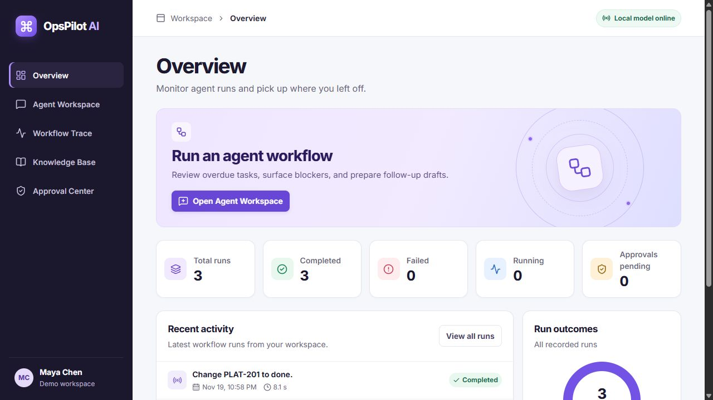

# OpsPilot AI

[](https://github.com/yonlysuraj/opspilot-ai/actions/workflows/checks.yml)

OpsPilot AI is a local agent workspace for triaging engineering work. It finds overdue tickets, verifies blockers, searches project runbooks for evidence, and saves follow-up drafts. A task status change pauses for an authorized decision. The dashboard shows the run history, citations, tool calls, and approval outcome.

The stack uses React, FastAPI, LangGraph, MCP over stdio, SQLite, and ChromaDB. Ollama runs chat and embeddings locally. The demo needs no hosted AI account or API key.

[Demo walkthrough](docs/demo.md) · [Architecture diagram](docs/architecture.md) · [API reference](docs/api.md) · [Benchmark](docs/benchmark.md)



## Quick start

Install **Python 3.12**, **uv 0.13.9**, **Node.js 24 with npm**, and **Ollama**. The commands below use PowerShell. On macOS or Linux, use your shell’s equivalent for copying `.env.example` and setting environment variables. [Install uv](https://docs.astral.sh/uv/getting-started/installation/) · [Ollama setup](https://docs.ollama.com/)

From the repository root, install dependencies from the lockfiles and copy the local settings.

```powershell
uv sync --locked --extra test
npm --prefix frontend ci
if (-not (Test-Path .env)) { Copy-Item .env.example .env }
```

To try approvals, generate a local credential with the command below. Put the output in `OPSPILOT_APPROVER_TOKEN` in `.env`. Use the same value in the Approval Center.

```powershell
uv run --locked --extra test python -c "import secrets; print(secrets.token_urlsafe(32))"
```

Start Ollama using its app or run `ollama serve` in a separate terminal. Pull the two models, seed the database, and start FastAPI.

```powershell
ollama pull qwen3:1.7b
ollama pull nomic-embed-text
uv run --locked --extra test python -m opspilot.seed
uv run --locked --extra test python -m uvicorn opspilot.main:app --host 127.0.0.1 --port 8000 --no-access-log
```

In another terminal, start Vite and open the dashboard.

```powershell
npm --prefix frontend run dev
```

[Dashboard](http://127.0.0.1:5173/) · [API docs](http://127.0.0.1:8000/docs) · [API readiness](http://127.0.0.1:8000/health/ready)

## Try the demo

1. In **Knowledge Base**, upload both TXT files in `data/sample_documents/`.
2. In **Agent Workspace**, send **Review blockers with sources**. Open the citations and both unsent drafts.
3. Open **Workflow Trace** and inspect the seven recorded MCP calls. Reload the conversation to verify that the run, citations, and drafts persisted.
4. In a new conversation, ask for a task status change. Review the exact change in **Approval Center**, enter the local token, and approve or reject it.
5. Open **Overview** to find the completed runs or any approvals still waiting. [Full demo walkthrough](docs/demo.md)

The demo uses a single seeded requester, Maya Chen. The approver token enables local task status decisions. The agent can save drafts and create proposals. The approval handler applies approved changes. PDF uploads require selectable text, and uploads are limited to 4 MB.

## Tests and evaluation

```powershell
uv run --locked --extra test pytest -q
npm --prefix frontend run build
uv run --locked --extra test python scripts/smoke.py
uv run --locked --extra test python evaluation/run.py
```

The automated suite uses deterministic model substitutes where needed. The smoke test calls the running API. The live evaluator uses Ollama and a temporary, seeded database. It checks tool sequences, evidence, drafts, and decision side effects. The portfolio benchmark passed 18 of 18 checks across three repetitions. [Measured benchmark and limitations](docs/benchmark.md)

GitHub Actions defines Windows and Ubuntu test jobs, a frontend build, and Docker image builds. The compose and workflow definitions passed local configuration checks. See the planner for the verification status.

## Run with Docker Compose

```powershell
docker compose up -d ollama
docker compose exec ollama ollama pull qwen3:1.7b
docker compose exec ollama ollama pull nomic-embed-text
docker compose up --build -d
```

Open [the Compose dashboard](http://127.0.0.1:8080/). The API reaches Ollama through the shared container network namespace. Named volumes preserve the models, SQLite records, checkpoints, and Chroma vectors. `docker compose logs api` shows operational events. `docker compose down` stops the stack and preserves the volumes. [Compose networking](https://docs.docker.com/compose/how-tos/networking/)

## Local model and setup notes

- **CPU inference.** The default `qwen3:1.7b` was tested on CPU. `qwen3:4b` is an optional larger chat model if memory permits. Set `OPSPILOT_OLLAMA_MODEL` in `.env` and pull the matching tag. [Qwen3 model tags](https://ollama.com/library/qwen3)
- **Model unavailable.** Check `ollama list` and the readiness endpoint. If Ollama listens on a different loopback port, set `OPSPILOT_OLLAMA_URL`. Missing embeddings are reported by indexing or search.
- **Windows startup.** Use a single Uvicorn process so the API can launch the MCP stdio subprocess. The API emits JSON events to stderr. Run duration includes any approval wait. [Architecture and operational boundaries](docs/architecture.md)
- **Prepared workspace.** If the portable runtime is already installed here, its Ollama endpoint is `http://127.0.0.1:11436`. Restart Ollama with the commands below. The prepared workspace also includes an npm CLI under `.local` for shells without npm on the path.

```powershell
$env:OLLAMA_MODELS = Join-Path $PWD ".local\ollama-models"
$env:OLLAMA_HOST = "127.0.0.1:11436"
$env:OLLAMA_NO_CLOUD = "1"
.\.local\ollama-0.35.1\ollama.exe serve
# In another terminal, with frontend dependencies installed
node .\.local\phase2-npm\package\bin\npm-cli.js --prefix frontend run dev
```

[Implementation planner](planner.md)
