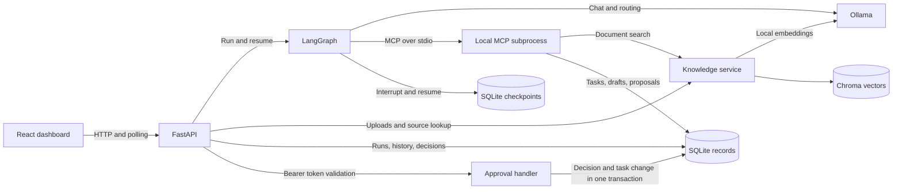

# Architecture

## Request and data flow

1. FastAPI creates a run and associates it with the current conversation. The dashboard polls persisted records while background work runs in the API process.
2. LangGraph routes the request through the local chat model. The graph validates and dispatches allowlisted tools through an official MCP SDK connection over stdio.
3. Document uploads are parsed into passages with stable IDs and PDF page or TXT line references. Ollama embeds the passages, and Chroma ranks them at query time. SQLite stores the source records, so the dashboard can resolve citations.
4. The overdue-blocker workflow verifies the ticket details and optionally searches the runbooks. The assistant generates follow-up text, and the MCP server saves it as an unsent local draft.
5. A task status request creates a proposal and pauses at a LangGraph checkpoint. The approval handler checks the bearer token, the stored checkpoint, and the task’s prior status. Approval records the decision and the task mutation in one SQLite transaction. Rejection records the decision and resumes the run.

| Component | Source | Responsibility |
| --- | --- | --- |
| API and settings | [main.py](../backend/opspilot/main.py), [config.py](../backend/opspilot/config.py) | HTTP contracts, scoped data access, and local configuration |
| Agent and MCP | [agent.py](../backend/opspilot/agent.py), [mcp_server.py](../backend/opspilot/mcp_server.py) | Routing, tool validation, timeouts, and trace events |
| Retrieval | [knowledge.py](../backend/opspilot/knowledge.py) | PDF/TXT parsing, local embedding, ranking, and source lookup |
| Persistence and approvals | [storage.py](../backend/opspilot/storage.py), [approval_flow.py](../backend/opspilot/approval_flow.py) | Run history, proposals, checkpoint validation, and idempotent decisions |
| Dashboard | [frontend/src](../frontend/src) | Overview, Agent Workspace, Workflow Trace, Knowledge Base, and Approval Center |
| Verification | [backend/tests](../backend/tests), [evaluation](../evaluation) | Deterministic integration tests and repeatable local model checks |

## Local trust boundary

The documented startup binds to loopback. Data views use the seeded Maya Chen requester, and a configured bearer token represents the local approver. This is a single-user demo identity model. Tool results and document excerpts are untrusted. The agent can propose a task change, and the approval handler exclusively applies the mutation. The tool registry has no shell execution, email sending, or remote task writes.

The API runs as one process. Background runs interrupted by a restart are marked failed. Pending approvals survive using the checkpoint database, and startup can resume a decision that committed before completion was recorded. Keep the main database, checkpoint database, and vector directory together when preserving a demo.
